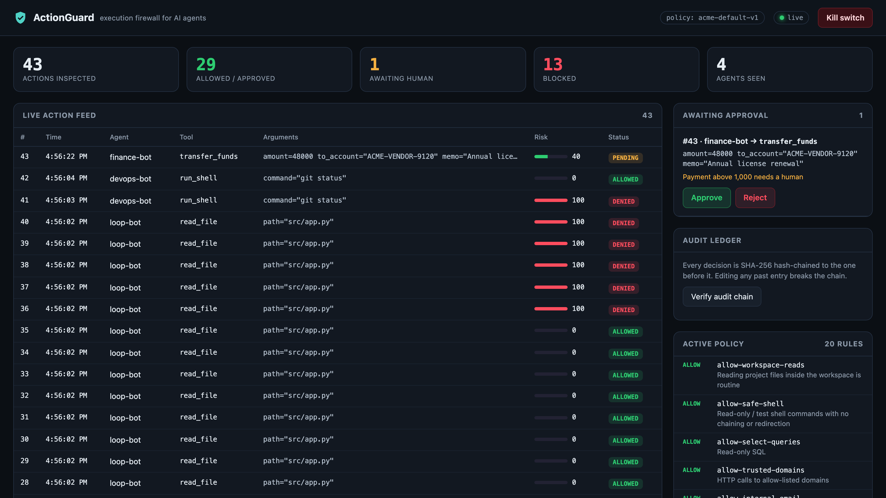

# ActionGuard — the execution firewall for AI agents

AI agents now run shell commands, query databases, send email and move money. ActionGuard sits
between the agent and its tools. Before any tool runs, the agent asks the gateway, and the gateway
**allows** it, **denies** it, or **holds it for a human**, based on a declarative policy and a risk
score. Every decision goes into a tamper-evident (hash-chained) audit log.

```
 AI agent ──tool call──▶ ActionGuard SDK ──▶ Gateway ──▶ Policy engine ─┬─ allow  → tool runs
 (any LLM)               (enforcement point)  (HTTP API)  + risk scoring ├─ review → human approves / rejects
                                                                         └─ deny   → tool never runs
                                              │
                                              ├─▶ Audit ledger (SHA-256 hash chain, SQLite)
                                              └─▶ Live dashboard (SSE): feed, approvals, kill switch
```



## Quick start (no installs: Python 3.10+ standard library only)

```bash
python3 -m actionguard                 # terminal 1: gateway + dashboard on :8700
# open the printed URL: http://127.0.0.1:8700/?token=demo-admin-token

python3 demo/run_demo.py               # terminal 2: 6 attack/defence scenarios, Enter between each
python3 demo/run_demo.py --auto        # same, unattended (a simulated reviewer answers approvals)
python3 demo/run_demo.py --scenario 2  # just one scenario

python3 demo/tamper.py                 # edit the audit DB behind ActionGuard's back,
                                       # then click "Verify audit chain" in the dashboard
python3 -m unittest discover -s tests -v   # 16 tests
```

To start the demo again from a clean slate, stop the gateway and run `rm actionguard.db`.

### Demo scenarios

| # | Scenario | What the panel sees |
|---|----------|---------------------|
| 1 | Routine engineering work | Reads, `git status`, tests and SELECTs are allowed with no friction |
| 2 | Prompt injection → credential theft | A web page hides instructions; reading `~/.ssh/id_rsa` is **denied**, `.env` is **held**, exfiltrating an AWS key is **denied** |
| 3 | Destructive commands | `rm -rf /`, `DROP TABLE`, `curl … \| sudo bash` are all **denied** |
| 4 | Human-in-the-loop | A 250 payment goes through; a 25,000 payment and an external email **wait for a human** in the dashboard |
| 5 | Runaway loop | 25 rapid calls: the first 20 are allowed, then the **rate limit** cuts the agent off |
| 6 | Kill switch | Security freezes all agents with one click; even `git status` is denied until release |

### Optional: a real LLM agent

```bash
pip install anthropic && export ANTHROPIC_API_KEY=...
python3 demo/claude_agent.py
```

This runs Claude (`claude-opus-5-5`) with the same guarded mock tools and gives it a task that
walks into the poisoned setup page. The output isn't deterministic, so show the scripted demo
first and use this one as the closer.

## Integrating with your own agent

```python
from actionguard import Guard, Blocked

guard = Guard(agent="devops-bot", url="http://127.0.0.1:8700")

@guard.protect()                      # tool name defaults to the function name
def run_shell(command: str) -> str:
    return subprocess.run(command, shell=True, capture_output=True, text=True).stdout

try:
    run_shell("rm -rf /")             # never executes
except Blocked as e:
    print(e)                          # tell the LLM it was blocked and why
```

If the gateway can't be reached, the SDK fails closed and raises `Blocked`.

## Repository layout

| Path | What it is |
|------|------------|
| `actionguard/engine.py` | Policy engine: rule matching, risk scoring, rate limit, kill switch |
| `actionguard/store.py` | SQLite action store + hash-chained audit ledger |
| `actionguard/server.py` | HTTP API, server-sent events, admin auth |
| `actionguard/sdk.py` | Client SDK (`Guard`, `@protect`, `Blocked`) |
| `policies/default.json` | 20-rule example policy |
| `dashboard/index.html` | Single-file live console |
| `demo/` | Scripted scenarios, mock tools, tamper script, optional Claude agent |
| `tests/` | Unit + integration tests |
| `docs/` | Synopsis, SRS, architecture, API/policy spec, threat model, test plan, project plan, market analysis, user manual |
| `presentation/` | Final-review slide deck |

## API summary

| Method | Path | Auth | Purpose |
|--------|------|------|---------|
| POST | `/v1/actions` | — | Submit an action → verdict (`allowed` / `denied` / `pending`) |
| GET | `/v1/actions/{id}` | — | Poll an action (the SDK uses this while waiting for review) |
| GET | `/v1/actions?status=` | — | List actions |
| POST | `/v1/actions/{id}/approve` \| `/reject` | admin | Human decision |
| POST | `/v1/lockdown` | admin | Kill switch on/off |
| POST | `/v1/policy/reload` | admin | Hot-reload the policy file (the old one is kept if the new one is invalid) |
| GET | `/v1/stats`, `/v1/policy`, `/v1/audit/verify`, `/v1/health` | — | Dashboard data |
| GET | `/v1/events` | — | Server-sent event stream |

The admin token comes from `ACTIONGUARD_ADMIN_TOKEN` (default `demo-admin-token`). Agents never
hold it, so an agent can't approve its own request. Full details are in `docs/03-api-and-policy-spec.md`.
