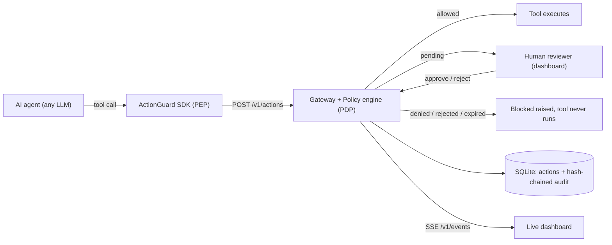

# Project Synopsis

| | |
|---|---|
| **Project title** | ActionGuard: an execution firewall for AI agents |
| **Domain** | AI Security / Cyber Security |
| **Degree** | B.Tech / B.E., Computer Science and Engineering (Final-year project) |
| **Team** | `<Student Name 1>` (`<Roll No.>`), `<Student Name 2>` (`<Roll No.>`), `<Student Name 3>` (`<Roll No.>`) |
| **Guide** | `<Guide Name>`, `<Designation>`, Department of CSE |
| **Institution** | `<College>`, `<University>` |
| **Academic year** | 2026–27 |

---

## 1. Abstract

Large language model (LLM) agents now call tools that change the world: they run shell commands, query and modify databases, send email, make HTTP requests and transfer money. Most current defences work at the prompt level. They classify or filter the text going into or out of the model. An agent that has been manipulated by a prompt injection, or that simply makes a mistake, can still issue a harmful tool call. ActionGuard places a policy enforcement point between the agent and its tools. Before any protected tool runs, the agent's SDK submits the proposed action (agent name, tool name, arguments) to a local gateway. The gateway evaluates it against a declarative JSON policy and computes an additive risk score. It returns one of three verdicts: **allow**, **deny**, or **review** (hold for a human). Global controls are evaluated before rules: a kill switch and a per-agent rate limit. Pending approvals that nobody answers expire after a timeout and are treated as denied (fail-closed). If the gateway is unreachable, the SDK also blocks. Every decision is written to an append-only audit ledger in SQLite, linked by a SHA-256 hash chain so that later edits are detectable. A live web dashboard shows the action feed, pending approvals, chain verification and the kill switch. The prototype uses only the Python 3.10+ standard library. It ships with a 20-rule example policy, six scripted attack and defence scenarios, and 15 automated tests, all of which pass.

## 2. Problem statement

LLM agents are given tools and then trusted to use them correctly. Two facts make that trust unsafe:

1. **The model cannot reliably tell instructions from data.** Text that an agent reads (a web page, an email, a file) can contain instructions that the model follows. This is indirect prompt injection.
2. **Tool calls have real side effects.** A single `rm -rf`, `DROP TABLE`, outbound HTTP POST of a credential, or large payment can cause irreversible damage.

Existing guardrails mostly inspect prompts and completions. They do not sit on the path where a tool call becomes an effect, and they usually do not offer human approval, a kill switch, or a tamper-evident record of what the agent actually tried to do. The problem this project addresses is:

> *How can an organisation enforce a deterministic, auditable policy on every action an AI agent attempts, independent of which model or prompt produced that action?*

## 3. Motivation

- **Agents are moving from chat to execution.** Coding agents, DevOps bots and finance assistants run with real credentials.
- **OWASP recognises the risk.** The *OWASP Top 10 for LLM Applications (2025)* lists **LLM01: Prompt Injection** and **LLM06: Excessive Agency** (too much functionality, permission or autonomy granted to an LLM-based system).
- **Security engineering has a known answer for untrusted actors.** Network firewalls, the XACML policy decision/enforcement split, Linux seccomp and `sudo` all mediate actions at the point of execution instead of trusting the caller's intent. This project applies that pattern to agent tool calls.
- **Accountability.** When an agent does something harmful, operators need a record that an insider cannot quietly rewrite.

## 4. Objectives

1. Design and implement a gateway that intercepts every protected agent tool call **before** it executes and returns `allow`, `review` or `deny`.
2. Define a declarative, human-readable **policy language** (JSON) with tool globs, regular-expression argument matching, numeric thresholds, and four rule effects (`allow`, `review`, `deny`, `flag`).
3. Implement **additive risk scoring** (0–100) with configurable thresholds that can escalate or deny an action even when a rule allows it.
4. Provide **human-in-the-loop** approval for high-impact actions, with an approval timeout that fails closed.
5. Provide global safety controls: a **kill switch** (lockdown) and a **per-agent rate limit** against runaway loops.
6. Record every decision in a **tamper-evident audit ledger** (SHA-256 hash chain) and expose an integrity-verification endpoint.
7. Provide a **client SDK** that makes protection a one-line decorator and **fails closed** if the gateway is unreachable.
8. Provide a **live dashboard** for reviewers (action feed, approvals, chain verification, kill switch) using server-sent events.
9. Separate privileges so that **an agent cannot approve its own request** (admin bearer token for all state-changing operations).
10. Validate the system with automated unit and integration tests and a reproducible scripted demonstration.

## 5. Scope

### In scope

- A single-host gateway (`python3 -m actionguard`) with HTTP API on `127.0.0.1:8700`.
- Policy engine: lockdown, rate limit, rule matching, strictest-effect resolution, risk thresholds.
- SQLite persistence: `actions` table (mutable state) and `audit` table (append-only hash chain).
- Python SDK (`Guard`, `@guard.protect()`, `Guard.check()`, `Blocked`).
- Single-file web dashboard with live updates.
- Example policy (`policies/default.json`, 20 rules) covering shell, SQL, HTTP, email, file and payment tools.
- Six simulated demo scenarios and an optional real-LLM demo (`demo/claude_agent.py`).
- Unit and integration tests (`tests/test_actionguard.py`).

### Out of scope (future work)

- Sandboxing or OS-level isolation of the tools themselves (the SDK is cooperative; see the threat model).
- Multi-node / horizontally scaled deployment, shared rate-limit state, Postgres backend.
- Per-user reviewer identities, SSO, role-based access control; the prototype has one shared admin token.
- Semantic or ML-based intent analysis of arguments; matching is regex/glob/numeric only.
- SDKs for languages other than Python (the HTTP API itself is language-neutral).
- External anchoring of the audit head hash (e.g. to a transparency log).

## 6. Proposed solution (summary)

ActionGuard follows the classic **Policy Enforcement Point (PEP) / Policy Decision Point (PDP)** split.

Evaluation order for each action: (1) lockdown → deny; (2) per-agent rate limit (default 20 actions / 10 s) → deny; (3) collect all matching rules; (4) the strictest deciding effect wins (`deny` > `review` > `allow`), with `default_decision` (`review`) if no rule decides; (5) risk = sum of matched rules' risk, capped at 100; risk ≥ 90 forces `deny`, risk ≥ 50 escalates `allow` to `review`.

## 7. Literature survey / related work

### 7.1 Prompt-level guardrails vs action-level enforcement

| Approach | Where it acts | Typical mechanism | Limitation for agents |
|---|---|---|---|
| Prompt/output guardrails | Text going into or out of the model | Classifiers, rules, LLM-as-judge on prompts and completions | Probabilistic; inspects language rather than the side effect; can be bypassed by novel injections |
| Action-level enforcement (this project) | The tool call, immediately before execution | Deterministic policy on tool name + arguments, human approval, audit | Sees only what the tool call exposes; the policy must anticipate dangerous argument patterns |

The two layers are complementary. ActionGuard does not inspect prompts. It assumes the model may already be compromised and limits what that model can *do*.

### 7.2 Industry and open-source tools (described generally)

- **NVIDIA NeMo Guardrails**: an open-source toolkit for adding programmable "rails" (input, output, dialogue and retrieval rails) to LLM applications, configured with its Colang language.
- **Guardrails AI**: an open-source Python framework for validating LLM outputs against validators and schemas, with corrective actions on failure.
- **Lakera Guard**: a commercial API that detects prompt injection, jailbreaks and data leakage in LLM inputs and outputs.
- **Meta LlamaFirewall**: an open-source guardrail framework for LLM agents that combines components such as a prompt-injection classifier, an agent-alignment/chain-of-thought auditor and code-safety scanning.
- **Invariant Labs (Invariant Guardrails / Analyzer)**: rule-based analysis of agent traces and tool calls to detect policy violations in agentic systems.

ActionGuard differs in emphasis. It is a small, self-hosted, deterministic decision point on the tool-call path, with human approval, rate limiting, a kill switch and a hash-chained ledger in one component. It does not attempt prompt-injection detection.

### 7.3 OWASP Top 10 for LLM Applications (2025)

- **LLM01: Prompt Injection.** User or third-party content alters the model's behaviour. ActionGuard addresses the *consequences* (the resulting tool calls), not the injection itself.
- **LLM06: Excessive Agency.** Damage results from excessive functionality, permissions or autonomy. OWASP's recommended mitigations include minimising permissions, requiring human approval for high-impact actions, and complete mediation. ActionGuard implements the last two directly.
- Also relevant: **LLM02 Sensitive Information Disclosure** (secret-exfiltration and PII rules) and **LLM10 Unbounded Consumption** (rate limit).

### 7.4 Classic security analogues

| Analogue | Idea borrowed |
|---|---|
| Network firewall | Ordered rules over a request's attributes; default action; explicit allow-lists |
| XACML PEP/PDP | Separate the point that intercepts a request (PEP) from the point that decides (PDP); combining algorithms such as *deny-overrides* |
| Linux seccomp | Filter on the *system call* an untrusted process makes, not on what it intends |
| `sudo` | Privileged operations require explicit authorisation and are logged |
| Tamper-evident logs (hash chains, Certificate Transparency) | Each record commits to its predecessor so edits are detectable |

## 8. Hardware and software requirements

### Hardware (development and demo)

| Item | Minimum |
|---|---|
| CPU | Any 64-bit x86-64 or ARM64 processor (measured on Apple M1) |
| RAM | 4 GB |
| Disk | 100 MB free (code is about 1.3 KLOC; the database grows with usage) |
| Network | None required; everything runs on `127.0.0.1` |

### Software

| Item | Version / note |
|---|---|
| OS | macOS, Linux or Windows |
| Python | 3.10 or newer (standard library only; developed and tested on 3.14.6) |
| SQLite | Bundled with Python's `sqlite3` module |
| Browser | Any modern browser with `EventSource` support (for the dashboard) |
| Optional | `anthropic` Python package and an API key, only for `demo/claude_agent.py` |

## 9. Expected outcomes

1. A working gateway that allows, denies or holds agent tool calls according to a declarative policy, before execution.
2. Demonstrable prevention of the attack classes in the demo: credential theft after prompt injection, destructive shell/SQL commands, remote-code execution, secret exfiltration, runaway loops, and unapproved high-value payments.
3. A tamper-evident audit trail whose integrity can be verified on demand, with tampering shown live using `demo/tamper.py`.
4. A measured decision overhead that is small compared with LLM inference latency (measured engine evaluation is about 0.13 ms; see [SRS NFR-1](01-SRS.md)).
5. A complete documentation set (SRS, design, API/policy specification, threat model, test plan, project plan, user manual).
