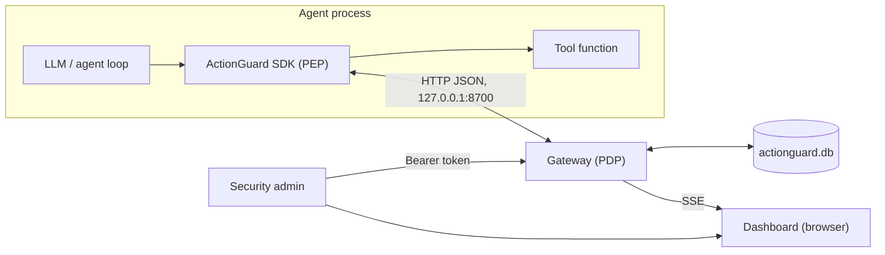
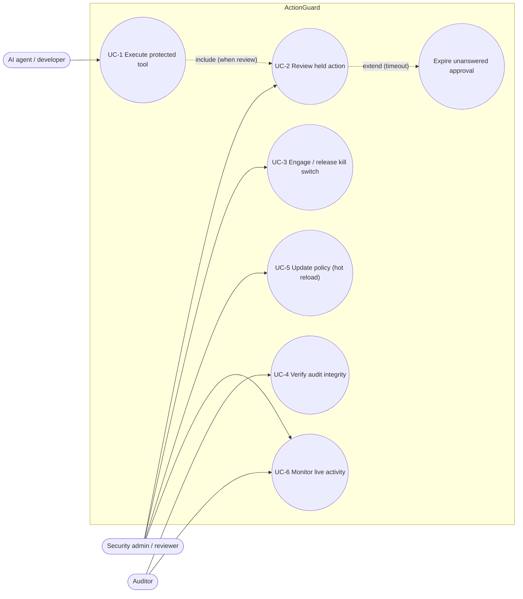

# Software Requirements Specification (SRS)

**Project:** ActionGuard, an execution firewall for AI agents
**Version:** 1.0 (matches `actionguard.__version__ = "1.0.0"`)
**Standard followed:** IEEE Std 830-1998 structure, with ISO/IEC/IEEE 29148:2018 requirement attributes
**Prepared by:** `<Student Name(s)>` **Guide:** `<Guide Name>` **Institution:** `<College>`

---

## 1. Introduction

### 1.1 Purpose
This document specifies the functional and non-functional requirements of ActionGuard, a gateway that decides whether a tool call proposed by an AI agent may execute. It is written for the project guide, the evaluation panel, and anyone who extends or tests the system. Every requirement is traceable to a module and to a test case (Section 7).

### 1.2 Scope
ActionGuard consists of:
- a **policy engine** (`actionguard/engine.py`) that maps `(agent, tool, args)` to `allow` / `review` / `deny` plus a risk score;
- a **store** (`actionguard/store.py`) holding action state and a hash-chained audit ledger in SQLite;
- an **HTTP gateway** (`actionguard/server.py`) exposing a REST API, a server-sent-event stream and the dashboard;
- a **Python SDK** (`actionguard/sdk.py`) that wraps agent tools and enforces the verdict;
- a **dashboard** (`dashboard/index.html`) for reviewers.

ActionGuard does not execute tools, sandbox processes, or inspect prompts. Those are outside its scope.

### 1.3 Definitions, acronyms and abbreviations

| Term | Meaning |
|---|---|
| **Agent** | A program, usually LLM-driven, that decides which tool to call with which arguments |
| **Action** | One proposed tool call: agent name, tool name, argument object |
| **Tool** | A function with side effects (shell, SQL, HTTP, email, payment, file read) |
| **Verdict / decision** | Engine output: `allow`, `review` or `deny` |
| **Status** | Lifecycle state of a stored action: `allowed`, `denied`, `pending`, `approved`, `rejected`, `expired` |
| **Effect** | What a rule contributes: `allow`, `review`, `deny`, or `flag` (adds risk only) |
| **Risk score** | Integer 0–100; sum of matched rules' `risk`, capped at 100 |
| **PEP** | Policy Enforcement Point. Intercepts the action and enforces the verdict (the SDK) |
| **PDP** | Policy Decision Point. Evaluates the policy and returns a verdict (the gateway/engine) |
| **HITL** | Human-in-the-loop. A person approves or rejects a held action |
| **SSE** | Server-Sent Events. One-way HTTP streaming of events from server to browser (`text/event-stream`) |
| **Kill switch / lockdown** | Global flag under which every action is denied |
| **Hash chain** | Sequence of records where each stores the SHA-256 of its content plus the previous record's hash |
| **Genesis hash** | `prev_hash` of the first audit record: 64 `0` characters |
| **Admin token** | Bearer secret (`ACTIONGUARD_ADMIN_TOKEN`) required for state-changing endpoints |
| **Fail closed** | On error or timeout, the outcome is "do not execute" |
| **OWASP LLM Top 10** | OWASP Top 10 for Large Language Model Applications, 2025 edition |

### 1.4 References
1. IEEE Std 830-1998, *Recommended Practice for Software Requirements Specifications*.
2. ISO/IEC/IEEE 29148:2018, *Systems and software engineering — Life cycle processes — Requirements engineering*.
3. OWASP, *Top 10 for LLM Applications 2025*.
4. OASIS, *eXtensible Access Control Markup Language (XACML) Version 3.0*: PEP/PDP model.
5. WHATWG HTML Living Standard, *Server-sent events*.
6. Project documents: [Architecture](02-architecture.md), [API & Policy spec](03-api-and-policy-spec.md), [Threat model](04-threat-model.md), [Test plan](05-test-plan.md).

### 1.5 Overview
Section 2 describes the product in context. Sections 3–5 list functional, non-functional and interface requirements. Section 6 gives use cases. Section 7 is the traceability matrix.

---

## 2. Overall description

### 2.1 Product perspective
ActionGuard is a self-contained component that runs beside an agent (a "sidecar" gateway on the same host). It is independent of the LLM vendor because it only sees tool calls.

### 2.2 Product functions (summary)
1. Accept and validate proposed actions.
2. Apply the kill switch and per-agent rate limit.
3. Match policy rules, resolve the decision, compute risk, apply thresholds.
4. Persist actions and append hash-chained audit records.
5. Hold `review` actions for human approval, and expire them after a timeout.
6. Authenticate administrative operations (approve, reject, lockdown, policy reload).
7. Stream events to the dashboard and expose read endpoints for state, stats and audit verification.
8. Enforce verdicts in the agent process through the SDK, failing closed.

### 2.3 User classes and characteristics

| User class | Description | Interacts through | Privilege |
|---|---|---|---|
| **Agent developer** | Integrates the SDK into an agent and writes tool functions | SDK, `POST /v1/actions`, `GET /v1/actions/{id}` | None (no admin token) |
| **Security admin / reviewer** | Writes the policy, approves or rejects held actions, operates the kill switch | Dashboard, admin endpoints | Admin token |
| **Auditor** | Checks after the fact what agents attempted and whether the log is intact | Dashboard ("Verify audit chain"), `GET /v1/audit/verify`, the SQLite file | Read-only |
| **AI agent** (non-human actor) | Proposes actions; must be assumed potentially compromised | SDK only | None |

### 2.4 Operating environment
- Python 3.10 or newer, standard library only, on macOS, Linux or Windows.
- Gateway binds `127.0.0.1:8700` by default (`--host`, `--port`, `--policy`, `--db` flags).
- Dashboard: any modern browser with `fetch` and `EventSource`.

### 2.5 Design and implementation constraints
- C-1: No third-party runtime dependencies (stdlib only).
- C-2: Single process; state for lockdown and rate limiting is held in memory.
- C-3: SQLite single-file database with one writer lock.
- C-4: The policy is a JSON file. Regular expressions use Python `re` syntax and are compiled case-insensitive.
- C-5: Agent and tool names must match `^[\w.\-:]{1,64}$`. The request body must not exceed 1,000,000 bytes.

### 2.6 Assumptions and dependencies
- A-1: Agents call tools only through SDK-wrapped functions. ActionGuard cannot stop an agent that has raw access to the underlying capability ([Threat model §7](04-threat-model.md)).
- A-2: The admin token is kept from agents and their environment.
- A-3: The host running the gateway is trusted. An attacker with write access to the DB file can tamper, but tampering is detected.
- A-4: Tool semantics are visible in the arguments (e.g. a shell command string) so that a regex policy can reason about them.

---

## 3. Functional requirements

Priority uses MoSCoW: **M** = Must, **S** = Should, **C** = Could.

| ID | Requirement | Pri. | Acceptance criteria |
|---|---|---|---|
| **FR-1** | **Submit action.** The system shall accept `POST /v1/actions` with body `{agent, tool, args}`, evaluate it, persist it, and return the full action record. | M | Response `201` with fields `id, ts, agent, tool, args, decision, status, risk, reasons, decided_by, decided_at`. `status` ∈ {`allowed`,`denied`,`pending`}. |
| **FR-2** | **Validate input.** `agent` and `tool` must match `^[\w.\-:]{1,64}$`; `args` must be a JSON object (default `{}`); the body must be a JSON object ≤ 1,000,000 bytes. | M | Invalid input → `400` with `{"error": ...}`; nothing is persisted. |
| **FR-3** | **Kill switch.** While lockdown is on, every action shall be denied with risk 100 and reason rule id `lockdown`, before any other check. | M | With lockdown on, `run_shell("ls")` → `deny`, reason `lockdown`. |
| **FR-4** | **Rate limit.** If an agent submits more than `rate_limit.max_actions` (default 20) actions within `rate_limit.window_seconds` (default 10), further actions shall be denied (risk 100, reason `rate-limit`) until the window slides. | M | 25 calls in 0.25 s → first 20 `allow`, last 5 `deny`; a call 60 s later → `allow`. |
| **FR-5** | **Rule matching.** A rule matches when the tool matches one of its `fnmatch` globs, every `when` regex matches (`re.search`, case-insensitive) the named argument (or the sorted JSON of all args for key `"*"`), and every `above` field is numerically greater than its limit. Missing or non-numeric fields do not match. | M | Unit tests show the expected rules in `reasons`. |
| **FR-6** | **Decision resolution.** The decision shall be the strictest deciding effect among matched rules (`deny` > `review` > `allow`; `flag` does not decide). If no deciding rule matched, `default_decision` applies (default `review`) and a reason with rule id `default` is added. | M | Unknown tool `launch_missiles` → `review` with reason `default`. |
| **FR-7** | **Risk scoring.** Risk = min(100, Σ risk of matched rules). If risk ≥ `deny_threshold` (90) → `deny`. Else if risk ≥ `review_threshold` (50) and decision is `allow` → `review`. | M | `.env` read → `review` (risk 60); force push → `review` (70); POST of card number to unknown domain → `deny` (90). |
| **FR-8** | **Persist action.** Every evaluated action shall be stored. The initial status is derived from the decision: `allow→allowed`, `deny→denied`, `review→pending`. | M | Row exists in `actions` with the mapped status. |
| **FR-9** | **Human review.** An admin shall approve or reject a `pending` action through `POST /v1/actions/{id}/approve` or `/reject`, recording `decided_by` (`by` field, default `admin`, max 64 chars) and `decided_at`. | M | Approve → status `approved`; a second approve → `409 not pending`. Expiry (FR-10) runs before the decision, so an overdue action cannot be approved. |
| **FR-10** | **Approval expiry (fail closed).** A `pending` action older than `approval_timeout_seconds` (default 120) shall become `expired` with `decided_by = "timeout"`. The SDK treats it as blocked. | M | With timeout 1 s, a pending action reads as `expired` after 1.5 s. |
| **FR-11** | **Admin authentication.** Approve, reject, lockdown and policy reload shall require header `Authorization: Bearer <ACTIONGUARD_ADMIN_TOKEN>`, compared in constant time. An empty configured token shall never authenticate. | M | No or wrong token → `401 {"error":"admin token required"}`. |
| **FR-12** | **Lockdown control.** `POST /v1/lockdown {enabled, by}` shall set or clear lockdown, write an audit event (`lockdown_on`/`lockdown_off`) and broadcast a `lockdown` event. | M | Response `{"lockdown": true}`; the dashboard shows the banner. |
| **FR-13** | **Policy validation and hot reload.** Policies with unknown effects, missing `id`/`tool`/`effect`, invalid regex, a non-integer `risk` or an invalid `default_decision` shall be rejected. `POST /v1/policy/reload` shall load the file again and, on any error, keep the old policy. | M | Bad file → `400 "policy rejected, old policy kept: ..."`; `GET /v1/policy` is unchanged. |
| **FR-14** | **Audit ledger.** Every evaluation, approval, rejection, expiry, lockdown change and policy reload shall append one record to `audit` with `prev_hash` and `hash = SHA-256(JSON[prev, ts, action_id, event, data])`. The first `prev_hash` is 64 zeros. | M | Events `evaluated`, `approved`, `rejected`, `expired`, `lockdown_on`, `lockdown_off`, `policy_reloaded` appear. |
| **FR-15** | **Chain verification.** `GET /v1/audit/verify` shall recompute the chain and return `{ok:true, checked, head}` or `{ok:false, broken_at, checked}`. | M | After `demo/tamper.py` edits one row, verification reports `ok:false` with that `seq`. |
| **FR-16** | **Live events.** `GET /v1/events` shall stream `data: {"type": "action"\|"lockdown"\|"policy", "data": ...}` messages, with a `: keepalive` comment after 15 s of inactivity. | S | A submitted action appears on the stream as type `action`. |
| **FR-17** | **Query endpoints.** The system shall provide `GET /v1/actions[?status=]` (newest first, max 200), `GET /v1/actions/{id}`, `GET /v1/stats`, `GET /v1/policy`, `GET /v1/health`. | M | Unknown id → `404`. |
| **FR-18** | **SDK enforcement.** `Guard.protect()` shall wrap a function so that the gateway is consulted with all bound arguments (defaults included) before the body runs. `allowed`/`approved` → run. `pending` → call `on_pending` once, then poll every `poll_seconds`. Any other status → raise `Blocked` without running the body. | M | `rm -rf /` raises `Blocked`; the body never executes. |
| **FR-19** | **SDK fail-closed.** If no decision can be obtained, the SDK shall raise `Blocked` and the tool shall not run. The status names the cause: `gateway-error` (the gateway returned an HTTP error, with code and body), `gateway-unreachable` (connection refused, timeout), `invalid-args` (arguments not JSON-serialisable). | M | `Guard(url="http://127.0.0.1:9").check(...)` raises `Blocked` with status `gateway-unreachable`. |
| **FR-20** | **Dashboard.** A single page at `/` shall show statistics, a live action feed with expandable reasons, pending approvals with Approve/Reject, audit verification, the active policy and a kill-switch toggle. The admin token comes from the `?token=` query parameter. | S | Visual check (see [User manual](08-user-manual.md)). |
| **FR-21** | **Configuration.** The gateway shall accept `--host`, `--port`, `--policy`, `--db`, read the token from `ACTIONGUARD_ADMIN_TOKEN` (default `demo-admin-token`, also used when the variable is empty), and print a warning when the default token is used. | S | Startup banner shows URL, policy name, rule count and DB path. |

---

## 4. Non-functional requirements

| ID | Category | Requirement | Measure / evidence |
|---|---|---|---|
| **NFR-1** | Performance | Engine evaluation shall take **< 10 ms** per action with the 20-rule default policy. | **Measured: median 0.133 ms, best 0.118 ms** per `Engine.evaluate` (mix of 6 representative actions, `timeit` 5 × 2000 rounds, rate limit disabled to avoid short-circuit; Apple M1, Python 3.14.6). Slowest single case 0.19 ms (unknown tool). |
| **NFR-2** | Performance | End-to-end decision (SDK → HTTP → engine → SQLite + audit → response) should be < 50 ms on localhost. | Measured: `Gateway.submit` 2.42 ms; SDK `check()` round trip median 3.09 ms, p95 10.75 ms (300 calls). |
| **NFR-3** | Security | An agent shall not be able to approve, reject, lock down or reload policy without the admin token. | FR-11; test `test_human_approval_flow` asserts `401`. |
| **NFR-4** | Security | All input from agents is untrusted: names are allow-list validated, the body size is bounded, and regex patterns come only from the policy file, never from requests. | FR-2; `test_input_validation`. |
| **NFR-5** | Reliability (fail-closed) | Every failure path shall result in non-execution: gateway unreachable, HTTP error, unanswered approval, invalid policy reload (old policy kept), unknown tool (default `review`). | FR-6, FR-10, FR-13, FR-19. |
| **NFR-6** | Auditability | Every decision and administrative change shall be recorded in an append-only, hash-chained log. Any modification of a past record shall be detectable. | FR-14, FR-15; `test_audit_chain_detects_tampering`. |
| **NFR-7** | Usability | Protecting a tool shall take one decorator line. A reviewer shall be able to approve or reject in one click and see the rule ids and descriptions that triggered the hold. | SDK `@guard.protect()`; dashboard reason list. |
| **NFR-8** | Portability | Runs on any OS with Python 3.10+, with no package installation. | Stdlib-only imports. |
| **NFR-9** | Maintainability | Small modules with single responsibilities (engine ~130 LOC, store ~130, server ~210, SDK ~70). Policy changes need no code changes. | `wc -l`; JSON policy. |
| **NFR-10** | Explainability | Each verdict shall carry the list of matched rules with effect, risk and description. | `reasons` array in every action. |
| **NFR-11** | Availability of controls | The kill switch shall take effect for the very next evaluation. | Engine checks `lockdown` first; demo scenario 6. |

---

## 5. External interface requirements

### 5.1 User interface
The dashboard is a single HTML page served at `GET /`, opened as `http://127.0.0.1:8700/?token=<admin token>`. It contains five stat tiles (Actions inspected, Allowed / approved, Awaiting human, Blocked, Agents seen), a live action feed, an *Awaiting approval* panel, an *Audit ledger* panel with *Verify audit chain*, an *Active policy* panel, and a *Kill switch* button that switches to *Release lockdown* plus a red banner while engaged. See [User manual §3](08-user-manual.md#3-dashboard-tour).

### 5.2 Software interface: REST API
JSON over HTTP/1.1. The full reference is in [03-api-and-policy-spec.md](03-api-and-policy-spec.md).

| Method | Path | Auth |
|---|---|---|
| POST | `/v1/actions` | none |
| GET | `/v1/actions`, `/v1/actions/{id}` | none |
| POST | `/v1/actions/{id}/approve`, `/v1/actions/{id}/reject` | admin |
| POST | `/v1/lockdown`, `/v1/policy/reload` | admin |
| GET | `/v1/stats`, `/v1/policy`, `/v1/audit/verify`, `/v1/health`, `/v1/events`, `/` | none |

### 5.3 Software interface: SDK
`from actionguard import Guard, Blocked`; `Guard(agent, url="http://127.0.0.1:8700", poll_seconds=1.0, on_pending=None)`; `Guard.protect(tool=None)`; `Guard.check(tool, **args)`; exception `Blocked(action)` with attribute `.action`.

### 5.4 Communication interfaces
HTTP on loopback, default port 8700. SSE uses `Content-Type: text/event-stream`. No TLS in the prototype (loopback only; TLS is future work for remote deployment).

---

## 6. Use cases

### 6.1 Use-case diagram

### 6.2 Use-case descriptions

**UC-1: Execute protected tool**
| Field | Value |
|---|---|
| Actor | AI agent (via SDK) |
| Precondition | Gateway running; tool wrapped with `@guard.protect()` |
| Main flow | 1. Agent calls the tool. 2. SDK binds the arguments and sends `POST /v1/actions`. 3. Engine evaluates and the store records the action. 4. Status `allowed` → the SDK runs the function body and returns its result. |
| Alternate flows | 4a. `denied` → `Blocked` raised and the body does not run. 4b. `pending` → `on_pending` callback, then polling (UC-2). 4c. Gateway unreachable → `Blocked` (`gateway-unreachable`); gateway returns an HTTP error → `Blocked` (`gateway-error`); arguments not JSON-serialisable → `Blocked` (`invalid-args`). |
| Postcondition | Action row and `evaluated` audit record exist; SSE `action` event published. |

**UC-2: Review held action**
| Field | Value |
|---|---|
| Actor | Security reviewer |
| Precondition | An action with status `pending`; reviewer holds the admin token |
| Main flow | 1. Pending card appears in *Awaiting approval* with arguments and reasons. 2. Reviewer clicks Approve or Reject. 3. Gateway sets `approved`/`rejected`, `decided_by`, `decided_at`, appends an audit record and broadcasts. 4. The SDK's next poll sees the final status and runs or blocks. |
| Alternate flows | 2a. No decision within 120 s → `expired` (`decided_by = "timeout"`), and the agent is blocked. 3a. The action is no longer pending → `409`. 3b. Missing token → `401`. |

**UC-3: Engage / release kill switch**
| Field | Value |
|---|---|
| Actor | Security admin |
| Main flow | 1. Click *Kill switch* (or `POST /v1/lockdown {"enabled": true}`). 2. Engine flag set; audit `lockdown_on`; SSE `lockdown` event; banner shown. 3. Every subsequent action → `deny` (rule `lockdown`). 4. *Release lockdown* reverses it (`lockdown_off`). |
| Note | Lockdown is held in memory. A gateway restart clears it (see [Threat model](04-threat-model.md)). |

**UC-4: Verify audit integrity**
| Field | Value |
|---|---|
| Actor | Auditor |
| Main flow | 1. Click *Verify audit chain* (or `GET /v1/audit/verify`). 2. Gateway recomputes every hash from genesis. 3. Result shows "Chain intact — N entries" and the head hash, or the first broken `seq`. |

**UC-5: Update policy**
| Field | Value |
|---|---|
| Actor | Security admin |
| Main flow | 1. Edit `policies/default.json` (or the file given with `--policy`). 2. `POST /v1/policy/reload` with the admin token. 3. New policy validated and swapped in; audit `policy_reloaded`; SSE `policy` event. |
| Alternate flow | 3a. Invalid policy → `400`, and the old policy stays active. |

**UC-6: Monitor live activity**
| Field | Value |
|---|---|
| Actors | Admin, auditor |
| Main flow | 1. Open the dashboard. 2. It loads `/v1/actions`, `/v1/stats`, `/v1/policy`, then subscribes to `/v1/events`. 3. New actions and status changes appear in real time; clicking a row expands its reasons and arguments. |

---

## 7. Requirements traceability matrix

Test-case IDs refer to [05-test-plan.md](05-test-plan.md). TC-01 to TC-15 and TC-31 are the 16 automated tests in `tests/test_actionguard.py`; TC-16 to TC-30 are system and security tests executed against a running gateway.

| Req. | Module(s) | Test case(s) |
|---|---|---|
| FR-1 | `server.py` `do_POST`, `Gateway.submit` | TC-11, TC-16 |
| FR-2 | `server.py` `NAME_RX`, `_json_body` | TC-14, TC-29 |
| FR-3 | `engine.py` `Engine.evaluate` | TC-09, TC-21 |
| FR-4 | `engine.py` `_over_rate_limit` | TC-08, TC-20 |
| FR-5 | `engine.py` `_rule_matches` | TC-01, TC-02, TC-03, TC-07, TC-31 |
| FR-6 | `engine.py` `Engine.evaluate` | TC-01, TC-02, TC-03, TC-06 |
| FR-7 | `engine.py` `Engine.evaluate` | TC-04, TC-05 |
| FR-8 | `store.py` `Store.record`, `FINAL` | TC-11, TC-16 |
| FR-9 | `store.py` `Store.resolve`, `server.py` | TC-12, TC-19, TC-25 |
| FR-10 | `store.py` `expire_stale`, `Gateway.expire` | TC-27 |
| FR-11 | `server.py` `_is_admin` | TC-12, TC-24 |
| FR-12 | `Gateway.set_lockdown`, `server.py` | TC-21 |
| FR-13 | `engine.py` `Policy`, `Gateway.reload_policy` | TC-10, TC-26, TC-31 |
| FR-14 | `store.py` `_append_audit`, `_hash` | TC-15, TC-22 |
| FR-15 | `store.py` `verify_chain` | TC-15, TC-22 |
| FR-16 | `server.py` `_stream`, `Gateway.publish` | TC-28 |
| FR-17 | `server.py` `do_GET`, `Store.list/get/stats` | TC-23, TC-25 |
| FR-18 | `sdk.py` `Guard.protect/check` | TC-11, TC-12, TC-16 to TC-21 |
| FR-19 | `sdk.py` `Guard.check` | TC-13 |
| FR-20 | `dashboard/index.html` | TC-30 |
| FR-21 | `server.py` `main` | TC-30 |
| NFR-1, NFR-2 | `engine.py`, whole stack | Benchmark in [05-test-plan.md §7](05-test-plan.md#7-performance-measurement) |
| NFR-3 | `server.py` | TC-12, TC-24 |
| NFR-5 | `sdk.py`, `store.py`, `engine.py` | TC-06, TC-13, TC-26, TC-27 |
| NFR-6 | `store.py` | TC-15, TC-22 |
