# System Architecture and Design (HLD + LLD)

This document describes how ActionGuard is built. Every name used here (classes, functions, endpoints, columns, rule ids) is taken from the source in `actionguard/`.

---

## 1. Architectural style

### 1.1 PEP / PDP separation
ActionGuard follows the XACML access-control model:

| Role | ActionGuard component | Responsibility |
|---|---|---|
| **PEP**: Policy Enforcement Point | `Guard` in `actionguard/sdk.py`, running inside the agent process | Intercepts each tool call, asks for a decision, runs the function body only on `allowed`/`approved` |
| **PDP**: Policy Decision Point | `Engine` in `actionguard/engine.py` | Pure decision logic: lockdown, rate limit, rule matching, risk |
| **PAP**: Policy Administration Point | `policies/default.json` + `POST /v1/policy/reload` | Where the policy is written and activated |
| **PIP / state** | `Store` in `actionguard/store.py` | Persists actions, statuses and the audit chain |

Keeping the decision out of the agent process matters for two reasons. The policy, admin token, approvals and audit log are not in memory that a compromised agent controls. And one gateway can serve many agents.

### 1.2 Sidecar gateway
The gateway is a separate local process on `127.0.0.1:8700`, deployed next to the agent like a service-mesh sidecar. It is language-neutral (plain HTTP + JSON). The Python SDK is a convenience client.

### 1.3 Layering inside the gateway

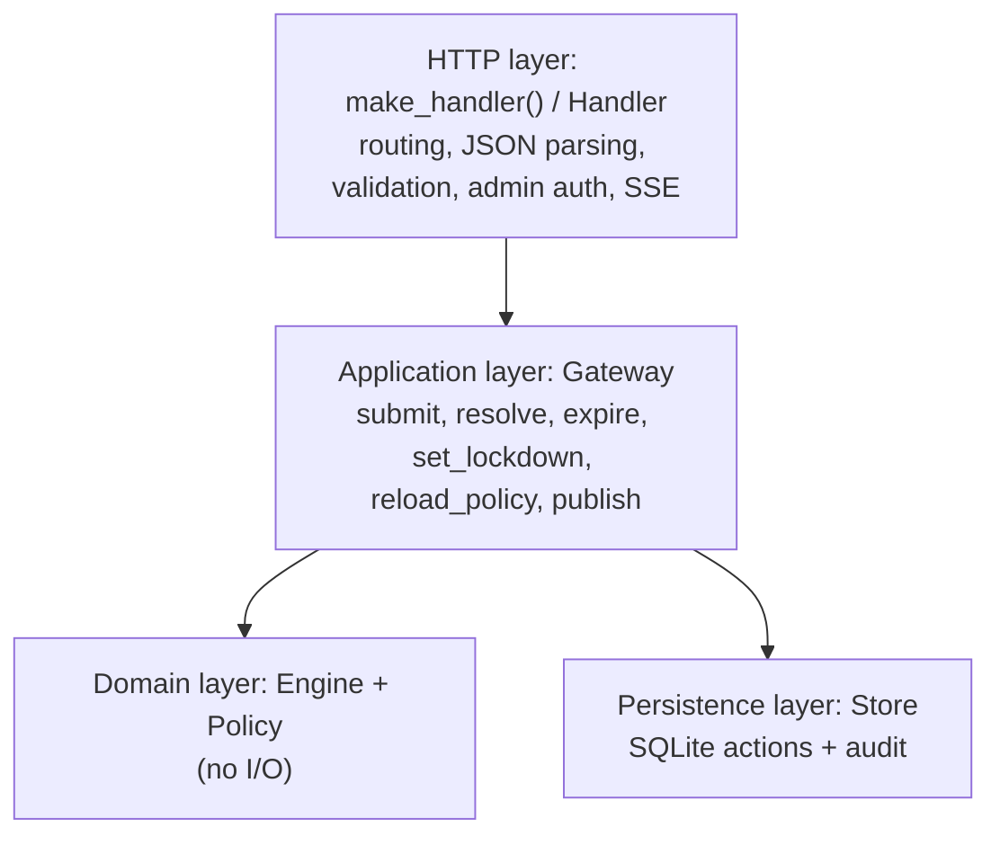

`Gateway` holds no HTTP code, so the tests can drive it directly (`tests/test_actionguard.py` reads `gw.store` in `GatewayTests`).

---

## 2. Component diagram

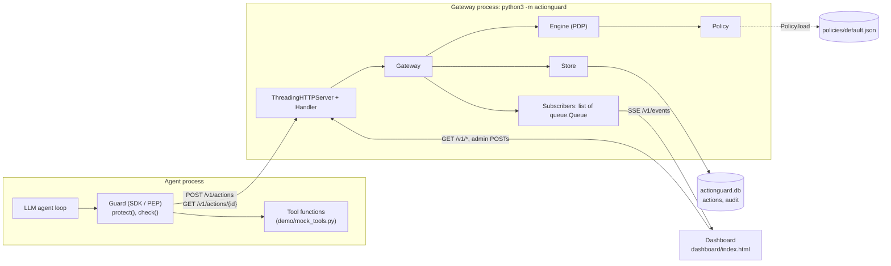

## 3. Deployment diagram

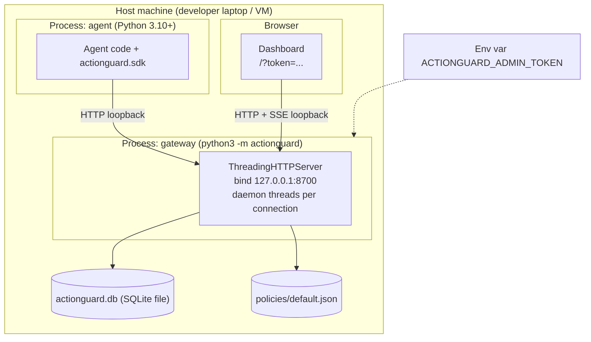

CLI flags: `--host` (default `127.0.0.1`), `--port` (default `8700`), `--policy` (default `policies/default.json`), `--db` (default `actionguard.db` in the project root).

---

## 4. Data-flow diagrams

### 4.1 DFD Level 0 (context diagram)

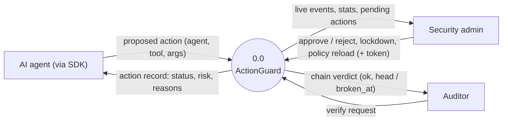

### 4.2 DFD Level 1

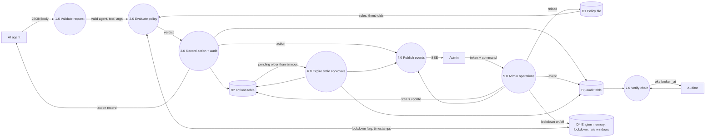

Process 6.0 runs lazily. `Gateway.expire()` is called at the start of every `GET` request, before every approve or reject (`Gateway.resolve`), and on each 15-second SSE keepalive tick, not by a dedicated timer thread. Running it before a decision means an overdue action cannot be approved. Because a waiting SDK polls `GET /v1/actions/{id}` every second, expiry is observed within about one poll interval of the deadline.

---

## 5. Sequence diagrams

### 5.1 Allowed action

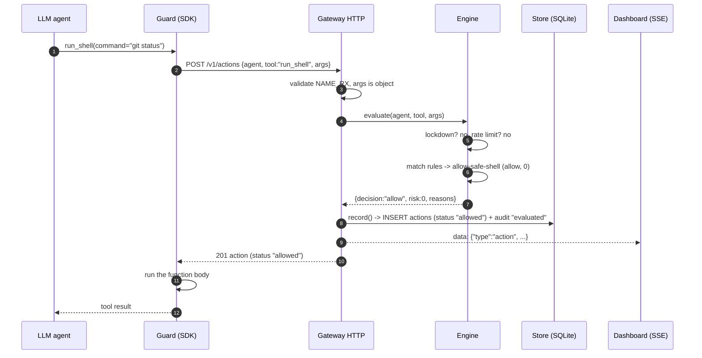

### 5.2 Denied action

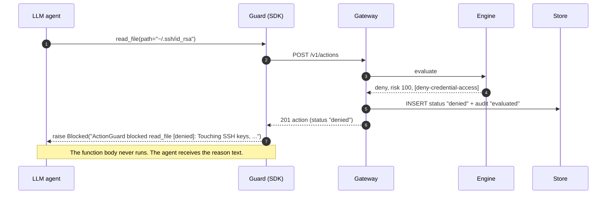

### 5.3 Human review with polling and expiry

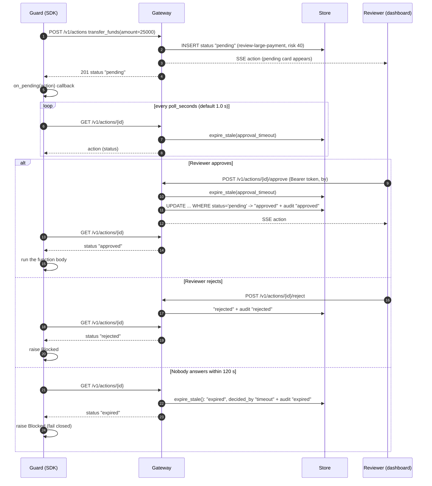

### 5.4 Kill switch

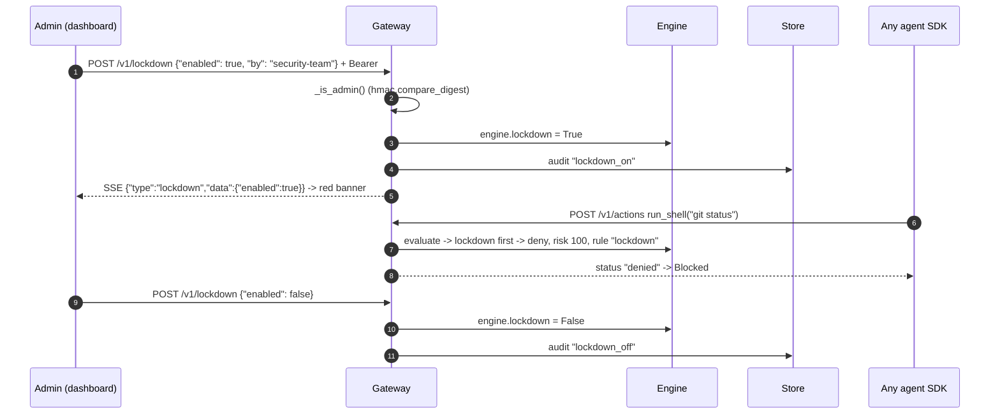

---

## 6. State diagram: action status lifecycle

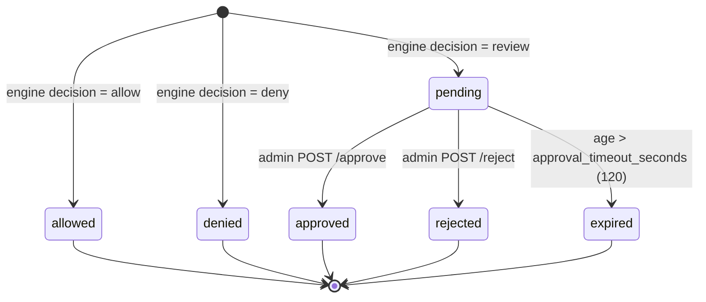

The mapping from decision to initial status is the `FINAL` dictionary in `store.py`. Only `pending` rows can change, because `Store.resolve` uses `UPDATE ... WHERE id=? AND status='pending'`. That conditional update makes approve, reject and expiry race-safe: the first transition wins and later attempts receive `409 not pending`. The SDK executes the tool only for `allowed` and `approved`.

---

## 7. Class diagram

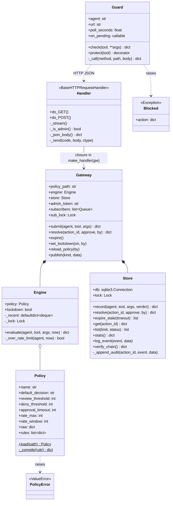

---

## 8. ER diagram

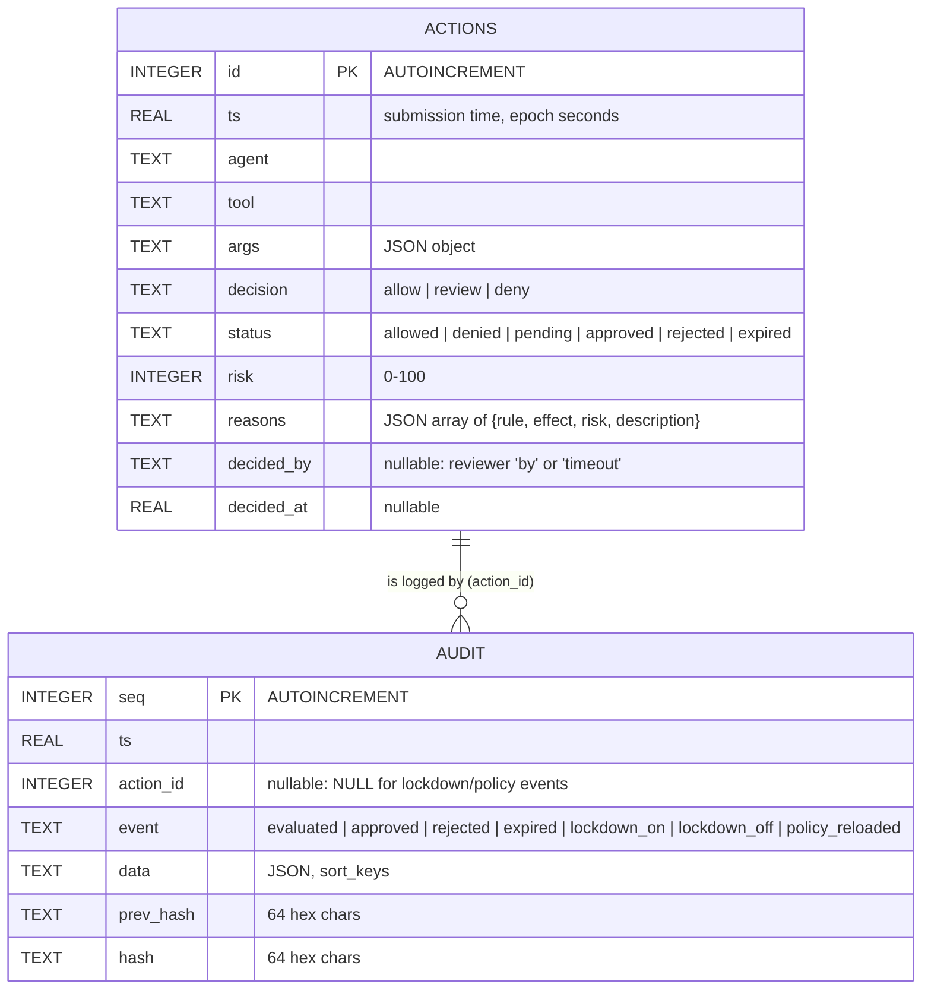

`actions` is **mutable state** (status changes over time). `audit` is the **append-only history**: the code only ever `INSERT`s into it. `action_id` is a logical reference with no declared `FOREIGN KEY` constraint, because system events (`lockdown_on`, `lockdown_off`, `policy_reloaded`) have no action.

---

## 9. Evaluation algorithm (LLD)

```text
STRICTNESS = {allow: 0, review: 1, deny: 2}

function EVALUATE(agent, tool, args, now = current_time):
    p ← engine.policy
    if engine.lockdown:
        return {decision: deny, risk: 100, reasons: [lockdown]}

    // per-agent sliding window, in memory, guarded by a lock
    q ← recent[agent]
    while q not empty and now − q.front > p.rate_window: q.pop_front()
    q.push_back(now)                                   // denied calls count too
    if |q| > p.rate_max:
        return {decision: deny, risk: 100, reasons: [rate-limit]}

    matched ← [r in p.rules where MATCHES(r, tool, args)]   // all rules, in file order
    reasons ← [(r.id, r.effect, r.risk, r.description) for r in matched]
    effects ← [r.effect for r in matched if r.effect ≠ flag]
    if effects not empty:
        decision ← argmax_{e in effects} STRICTNESS[e]     // strictest wins
    else:
        decision ← p.default_decision                       // "review" in default.json
        reasons.append(default)

    risk ← min(100, Σ r.risk for r in matched)               // allow/flag/review/deny all add
    if risk ≥ p.deny_threshold:            decision ← deny     // 90
    else if risk ≥ p.review_threshold and decision = allow:
                                           decision ← review   // 50
    return {decision, risk, reasons}

function MATCHES(rule, tool, args):
    if not any(fnmatch(tool, glob) for glob in rule.tools): return false
    for (field, regex) in rule.when:                        // AND across fields
        value ← (field = "*") ? json.dumps(args, sort_keys=True) : args.get(field)
        if value is None or not regex.search(str(value)):  return false   // case-insensitive
    for (field, limit) in rule.above:
        if args[field] missing or not numeric or float(args[field]) ≤ limit: return false
    return true
```

**Complexity.** O(R · (L + P)) per action, where R is the number of rules (20), L the argument length and P the regex cost. The rate-limit check is amortised O(1). There is no I/O in the engine. Measured mean cost is about 0.13 ms ([SRS NFR-1](01-SRS.md#4-non-functional-requirements)).

---

## 10. Hash-chain algorithm

```text
GENESIS ← "0" × 64

function APPEND(action_id, event, data):           // called inside Store.lock and a DB transaction
    prev ← hash of the last audit row by seq, or GENESIS if empty
    ts   ← time.time()
    d    ← json.dumps(data, sort_keys=True)
    h    ← SHA256( json.dumps([prev, ts, action_id, event, d], sort_keys=True) ).hex()
    INSERT audit(ts, action_id, event, data=d, prev_hash=prev, hash=h)

function VERIFY():
    prev ← GENESIS; count ← 0
    for row in audit ORDER BY seq:
        if row.prev_hash ≠ prev
           or row.hash ≠ SHA256(json.dumps([prev, row.ts, row.action_id, row.event, row.data], sort_keys=True)):
            return {ok: false, broken_at: row.seq, checked: count}
        prev ← row.hash; count ← count + 1
    return {ok: true, checked: count, head: prev}
```

**Properties.**
- Changing any field of record *i* changes its recomputed hash, so `VERIFY` stops at *i*.
- An attacker who also rewrites `hash` for record *i* breaks the `prev_hash` link of record *i+1*. Hiding the edit requires recomputing every later hash.
- Because the hash is unkeyed, an attacker with write access *can* recompute the whole chain, and deleting rows at the tail is not detected internally. Both are caught only if the head hash (returned by `/v1/audit/verify`) is recorded somewhere the attacker cannot write. That external anchoring is future work ([Threat model §7](04-threat-model.md#7-known-limitations)).
- Appending runs under `Store.lock` inside a SQLite transaction, so two concurrent writers cannot read the same `prev` hash.

---

## 11. Key design decisions (ADR style)

### ADR-1: Python standard library only
- **Context:** A security component's dependencies are part of its attack surface. The demo must also run on a panel laptop with no network.
- **Decision:** Use only `http.server`, `sqlite3`, `hashlib`, `hmac`, `re`, `fnmatch`, `json`, `threading`, `urllib`.
- **Consequences:** Zero install and no supply-chain risk. The cost is a basic HTTP server (no HTTP/2, no TLS termination, thread per connection), which is acceptable for a loopback sidecar.

### ADR-2: SQLite for persistence
- **Context:** Actions and the audit chain need durable, transactional storage.
- **Decision:** One SQLite file with two tables and a single writer lock (`Store.lock`).
- **Consequences:** ACID transactions make an action insert and its audit record atomic, and the file is easy to inspect and to tamper with for the demo. Write concurrency is limited to one writer, which is the ceiling noted in code (`# ponytail: one writer lock ... swap for Postgres at scale`).

### ADR-3: Fail closed everywhere
- **Context:** Under uncertainty, a firewall must choose between availability and safety.
- **Decision:** Gateway unreachable, gateway HTTP error or unserialisable arguments → `Blocked` (status `gateway-unreachable`, `gateway-error` or `invalid-args`). Unanswered approval → `expired`, and an overdue action cannot be approved. Unknown tool → `default_decision: review`. Any error during policy reload → keep the old policy and return `400`.
- **Consequences:** An outage stops agents instead of letting them run unchecked. Operators must keep the gateway available. This mirrors the default-deny posture of network firewalls.

### ADR-4: Strictest effect wins, risk is additive
- **Context:** Rule ordering is error-prone (first-match firewalls are fragile to reordering).
- **Decision:** Evaluate *all* rules. The decision is the most restrictive deciding effect (equivalent to XACML *deny-overrides*), and `flag` rules contribute only risk.
- **Consequences:** Rule order does not matter. A broad `allow` (e.g. `allow-workspace-reads`) can never override a specific `deny` (e.g. `deny-credential-access`). Several weak signals can add up to a decision (e.g. `flag-unknown-domain` 50 + `flag-pii` 40 = 90 → deny).

### ADR-5: Server-Sent Events instead of WebSockets
- **Context:** The dashboard needs live updates. Commands are rare and go through ordinary POSTs.
- **Decision:** One-way SSE on `GET /v1/events` with a 15 s keepalive comment.
- **Consequences:** Plain HTTP that the stdlib server can produce. Browsers reconnect `EventSource` automatically. No upgrade handshake or framing code is needed. The trade-off is that SSE is server→client only, which matches the requirement.

### ADR-6: A separate admin token for state-changing endpoints
- **Context:** If the same credential could submit and approve, a prompt-injected agent could approve its own request.
- **Decision:** Submission and polling need no token. Approve, reject, lockdown and policy reload require `Authorization: Bearer <ACTIONGUARD_ADMIN_TOKEN>`, compared with `hmac.compare_digest`. An empty configured token never authenticates, and an empty env var falls back to the warned default. The agent's `Guard` never sends it.
- **Consequences:** Separation of duties between actor and approver. The prototype has one shared token, so `decided_by` is self-declared. Per-user identities are future work.

### ADR-7: Deterministic rules instead of an LLM judge
- **Context:** An LLM classifier could judge intent, but it is probabilistic, slow (hundreds of milliseconds or more) and can itself be prompt-injected by the arguments it reads.
- **Decision:** Regex, glob and numeric predicates with explicit rule ids.
- **Consequences:** The same input always gives the same verdict, the reasons are explainable, evaluation is sub-millisecond, and the rules are testable. The cost is that regexes can be evaded by obfuscation (documented in the threat model). An LLM signal could be added later as a `flag`-style risk input, not as the sole decider.

---

## 12. Scalability path (future work)

None of the following is implemented. It is the planned evolution path.

| Concern | Current (v1.0) | Future |
|---|---|---|
| Storage | SQLite, one writer lock | PostgreSQL with row-level locking; audit chain in its own table or service |
| Rate limiting | In-memory per process (`Engine._recent`) | Shared counter (e.g. Redis) so limits hold across gateway replicas |
| Lockdown | In-memory flag, reset on restart | Persisted flag, loaded on startup and replicated |
| Availability | Single process | Several stateless gateway replicas behind a load balancer |
| Identity | Self-declared agent name; one admin token | Per-agent credentials (mTLS or signed tokens); reviewer SSO and RBAC |
| Transport | Plain HTTP on loopback | TLS for remote deployment |
| Enforcement | Cooperative SDK in the agent process | Tools behind the gateway (proxy/MCP gateway) or in a sandbox, so that the agent holds no raw credentials |
| Audit | Internal hash chain | Periodic external anchoring of the head hash (transparency log, WORM storage) |
| Expiry | Lazy, on GET / SSE keepalive | Background scheduler |
