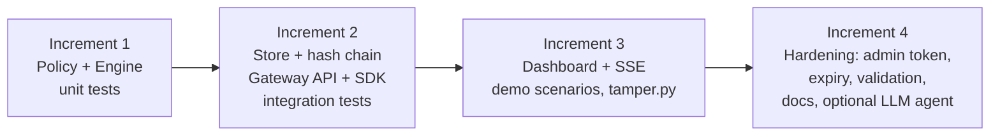
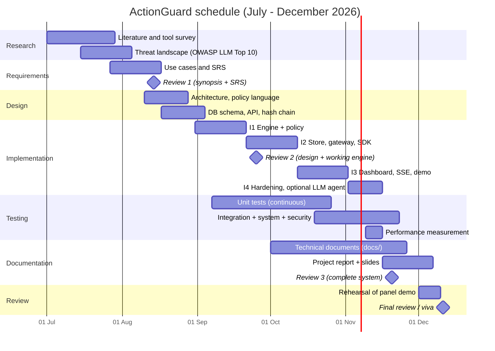

# Project Plan

**Project:** ActionGuard, an execution firewall for AI agents
**Duration:** July 2026 to December 2026 (about 24 weeks)
**Team:** see §8 (placeholders)

---

## 1. SDLC model: iterative and incremental

### 1.1 Choice
The project follows an **iterative and incremental** model. Each increment adds a working, tested slice of the system on top of the previous one, and the requirements and design are revisited at the start of each iteration.

### 1.2 Justification

| Factor | Why iterative/incremental fits |
|---|---|
| **New domain** | Agent security is evolving quickly (OWASP LLM Top 10 2025, new agent frameworks). Requirements such as the `flag` effect, the rate limit and approval expiry emerged from experiments, not from an upfront specification. Waterfall would freeze them too early. |
| **Risk-first ordering** | The riskiest part, whether a deterministic policy can separate safe from dangerous actions with low latency, is built and tested first (Increment 1). |
| **Periodic university reviews** | Each review needs a demonstrable artefact. Every increment ends with something runnable. |
| **Small team, fixed deadline** | Increments can be cut from the end (e.g. the optional Claude agent) without endangering the core. |
| **Testability** | Unit tests for the engine exist before the HTTP layer, and integration tests are added with the gateway. |

A pure Agile/Scrum process was not chosen because a student team has no product owner and no continuous delivery target. Waterfall was rejected for the reasons above. The spiral model's formal risk analysis per loop is more ceremony than a 1.3 KLOC system needs.

### 1.3 Increments

| Increment | Delivered modules | Exit test |
|---|---|---|
| I1 | `engine.py`, `policies/default.json` | `EngineTests` (11) pass |
| I2 | `store.py`, `server.py`, `sdk.py` | `GatewayTests` (5) pass |
| I3 | `dashboard/index.html`, `demo/run_demo.py`, `demo/mock_tools.py`, `demo/tamper.py` | All 6 scenarios run with `--auto`; tampering detected |
| I4 | Auth, expiry, input limits, `demo/claude_agent.py`, `docs/` | All 16 tests pass; system tests TC-16 to TC-30 pass; defects found in review fixed and re-tested (TC-31) |

---

## 2. Work breakdown structure

```mermaid
flowchart TB
    P["ActionGuard"]
    P --> W1["1 Project management"]
    P --> W2["2 Research"]
    P --> W3["3 Requirements"]
    P --> W4["4 Design"]
    P --> W5["5 Implementation"]
    P --> W6["6 Testing"]
    P --> W7["7 Documentation"]
    P --> W8["8 Reviews and viva"]

    W1 --> W11["1.1 Plan and schedule"]
    W1 --> W12["1.2 Risk tracking"]
    W1 --> W13["1.3 Guide meetings"]
    W2 --> W21["2.1 Agent frameworks and tool calling"]
    W2 --> W22["2.2 OWASP LLM Top 10, guardrail products"]
    W2 --> W23["2.3 Firewalls, XACML, seccomp, hash chains"]
    W3 --> W31["3.1 Use cases"]
    W3 --> W32["3.2 SRS"]
    W4 --> W41["4.1 Architecture: PEP/PDP"]
    W4 --> W42["4.2 Policy language"]
    W4 --> W43["4.3 DB schema and audit chain"]
    W4 --> W44["4.4 API design"]
    W5 --> W51["5.1 Engine"]
    W5 --> W52["5.2 Store"]
    W5 --> W53["5.3 Gateway + SSE"]
    W5 --> W54["5.4 SDK"]
    W5 --> W55["5.5 Dashboard"]
    W5 --> W56["5.6 Policy rules"]
    W5 --> W57["5.7 Demo + tamper + LLM agent"]
    W6 --> W61["6.1 Unit tests"]
    W6 --> W62["6.2 Integration tests"]
    W6 --> W63["6.3 System and security tests"]
    W6 --> W64["6.4 Performance measurement"]
    W7 --> W71["7.1 Synopsis, SRS, design"]
    W7 --> W72["7.2 Threat model, test report"]
    W7 --> W73["7.3 User manual, report"]
    W8 --> W81["8.1 Reviews 1-3"]
    W8 --> W82["8.2 Final demo and viva"]
```

---

## 3. Timeline

---

## 4. Risk register

Probability (P) and impact (I) are scored 1 (low) to 3 (high). Score = P × I.

| ID | Risk | P | I | Score | Mitigation | Contingency | Owner |
|---|---|---|---|---|---|---|---|
| R-1 | Scope creep (sandboxing, MCP gateway, multi-node) | 3 | 2 | 6 | Fixed scope in synopsis; extras listed as future work | Cut I4 extras | `<PM>` |
| R-2 | Live demo fails in front of the panel (port in use, network, laptop) | 2 | 3 | 6 | Fully offline, stdlib only; `--port` flag; rehearsed runbook | `run_demo.py --auto`; screenshots; pre-recorded run ([User manual §5](08-user-manual.md#5-panel-demo-runbook-about-8-minutes)) | `<Demo lead>` |
| R-3 | LLM API unavailable, costly or non-deterministic | 3 | 1 | 3 | Scripted demo uses mock tools and no API; the Claude agent is optional | Skip the encore | `<Dev>` |
| R-4 | Policy false positives or negatives | 2 | 3 | 6 | Unit tests per rule class; default `review`; threat-model probes | Log as defect, adjust regex, hot-reload. This happened: probes found DF-01, DF-02 and DF-11, the regexes were fixed and TC-31 now guards them | `<Security lead>` |
| R-5 | Security flaw discovered by examiners | 2 | 2 | 4 | Honest threat model and known-limitations section; defect log | Explain the mitigation path | All |
| R-6 | Team availability (exams, internships) | 2 | 2 | 4 | Buffer in schedule; parallel documentation | Reassign tasks | `<PM>` |
| R-7 | Loss of work | 1 | 3 | 3 | Version control and off-machine backup | Restore from backup | All |
| R-8 | Python version differences on the demo machine | 1 | 2 | 2 | Stdlib only; requires 3.10+; tested on 3.14.6 | Use a venv with a known version | `<Dev>` |
| R-9 | Concurrency bugs in gateway (threads + SQLite) | 2 | 2 | 4 | Single writer lock; conditional `UPDATE … WHERE status='pending'` | Serialise further | `<Dev>` |

---

## 5. Effort and cost estimation (basic COCOMO, organic mode)

### 5.1 Size

Measured with `wc -l actionguard/*.py demo/*.py dashboard/index.html tests/*.py` (physical lines, including comments and blank lines):

| File | Lines |
|---|---|
| `actionguard/__init__.py` | 5 |
| `actionguard/__main__.py` | 3 |
| `actionguard/engine.py` | 136 |
| `actionguard/sdk.py` | 76 |
| `actionguard/server.py` | 209 |
| `actionguard/store.py` | 133 |
| `demo/claude_agent.py` | 76 |
| `demo/mock_tools.py` | 56 |
| `demo/run_demo.py` | 167 |
| `demo/tamper.py` | 16 |
| `dashboard/index.html` | 272 |
| `tests/test_actionguard.py` | 197 |
| **Total** | **1346** |

KLOC = 1346 / 1000 = **1.346** (the policy JSON and documentation are excluded).

### 5.2 Formulas (organic mode: a = 2.4, b = 1.05, c = 2.5, d = 0.38)

$$E = a\,(\text{KLOC})^{b} \qquad D = c\,(E)^{d} \qquad P = E / D$$

### 5.3 Calculation

| Quantity | Working | Result |
|---|---|---|
| Effort E | 2.4 × 1.346^1.05 = 2.4 × 1.3661 | **3.28 person-months** |
| Development time D | 2.5 × 3.279^0.38 = 2.5 × 1.5703 | **3.93 months** |
| Average staffing P | 3.279 / 3.926 | **0.84 persons** |
| Productivity | 1346 / 3.279 | 411 LOC per person-month |

### 5.4 Interpretation

- Basic COCOMO estimates only the **design-to-test development** effort. It excludes research, literature survey, documentation and reviews, which take about half of the 6-month academic schedule. The ~3.9-month development estimate sits inside the implementation and testing window of the Gantt chart (late August to late November).
- 1.3 KLOC is far below the size range COCOMO was calibrated on, so the result should be read as an order-of-magnitude check, not a prediction.
- **Illustrative cost:** at a notional rate of ₹40,000 per person-month, development cost ≈ 3.28 × 40,000 ≈ **₹1.31 lakh**. Infrastructure cost is nil: stdlib only, local execution, no cloud services. The optional `demo/claude_agent.py` incurs per-call API charges.

---

## 6. Tools and technologies

| Category | Tool / technology | Use in the project |
|---|---|---|
| Language | Python 3.10+ (developed and tested on 3.14.6) | Gateway, engine, SDK, demo, tests |
| HTTP server | `http.server.ThreadingHTTPServer` (stdlib) | REST API, SSE, dashboard hosting |
| Database | SQLite via `sqlite3` (stdlib) | `actions` and `audit` tables |
| Cryptography | `hashlib` (SHA-256), `hmac.compare_digest` | Audit hash chain; constant-time token comparison |
| Matching | `re`, `fnmatch` (stdlib) | Policy `when` regexes, tool globs |
| Concurrency | `threading`, `queue` | Per-connection threads, SSE fan-out, locks |
| HTTP client | `urllib.request` | SDK, demo admin calls |
| Testing | `unittest` | 16 unit and integration tests |
| Front end | HTML, CSS, vanilla JavaScript, `EventSource` | Single-file dashboard, no build step |
| Optional LLM | `anthropic` Python SDK, model `claude-opus-5-5` | `demo/claude_agent.py` encore |
| Documentation | Markdown, Mermaid | `docs/` |
| Version control | Git (recommended) | Source history and backups |

---

## 7. Communication and reviews

| Activity | Frequency | Participants | Output |
|---|---|---|---|
| Guide meeting | Weekly | Team + guide | Minutes, action items |
| Internal stand-up | Twice weekly | Team | Task status |
| University review | Review 1 (14 Aug), Review 2 (25 Sep), Review 3 (20 Nov), Final (11 Dec) | Team, panel | Feedback incorporated into next increment |

---

## 8. Team

| Name | Roll No. | Programme |
|---|---|---|
| Prashant Kumar Yadav | LCI2023025 | CSAI |
| Dishant Garg | LCB2023011 | CSB |
| Gagan Mishra | LCI2023038 | CSAI |
| Gaurav Ghodinde | LCB2023032 | CSB |
| Pranay Naman Buradkar | LIT2023027 | IT |

Guide: `<Guide Name>`. Institution: Indian Institute of Information Technology, Lucknow (IIIT Lucknow).

### Work packages

Fill in the owner of each package. The panel may ask who built what.

| Work package | Owner(s) | Responsibilities |
|---|---|---|
| Project lead / PM | `<assign>` | Schedule, risk register, integration, reviews |
| Policy engine & security | `<assign>` | `engine.py`, `policies/default.json`, threat model |
| Backend & SDK | `<assign>` | `server.py`, `store.py`, `sdk.py` |
| Front end & demo | `<assign>` | `dashboard/index.html`, `demo/`, panel runbook |
| Testing & documentation | `<assign>` | `tests/`, `docs/` |
